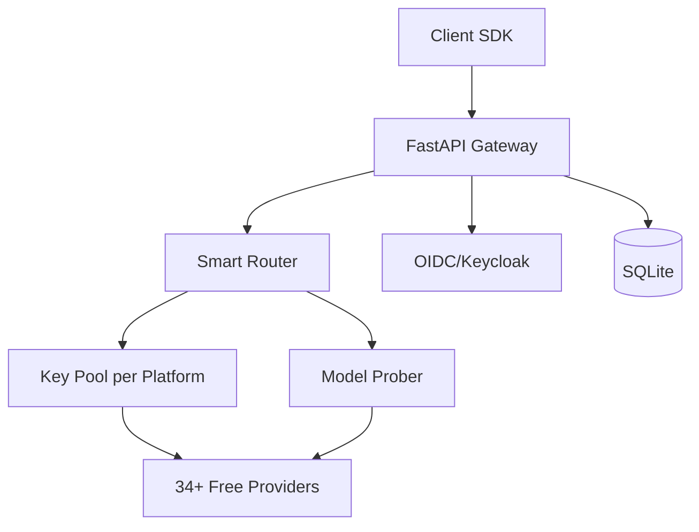

# sentinel-engine-ryan-vo — Ryan Vo

> Work in progress. This checkpoint may be incomplete or fail tests. See PLAN.md and STATUS.md before use.


Ryan Vo | AI & Machine Learning

**Sentinel Engine** is an LLM gateway that aggregates 34+ free LLM providers (635+ model endpoints) behind a single OpenAI-compatible `/v1` endpoint. It provides smart routing, automatic failover, encrypted key storage, and per-model capability probing for personal experimentation.

## Problem

Free LLM APIs are fragmented across dozens of providers with different endpoints, authentication schemes, and reliability characteristics. Developers waste time managing multiple API keys, handling failover manually, and discovering which models actually support tool calls vs chat-only.

## Approach

Sentinel Engine implements a unified gateway with:
- **Unified API**: Single `/v1/chat/completions` and `/v1/models` endpoint compatible with OpenAI SDK
- **Smart routing**: Multi-key pooling with per-key concurrency limits, health-aware selection, and automatic failover
- **Proactive probing**: Background scheduler classifies models as `tool_capable`, `chat_only`, `unavailable`, or `unknown` before routing real traffic
- **Failure attribution**: Distinguishes provider-level rate limits (429) from model-level failures (404) to avoid polluting model scores
- **Streaming keep-alive**: SSE pings during long reasoning windows prevent client idle timeouts

## Architecture



## AI/ML Evaluation

Sentinel Engine includes a reproducible model capability evaluation:

```bash
# Run capability probe evaluation
cd backend && python -m pytest tests/test_prober.py -v
```

**Baseline**: Passive observation only (current freellmapi behavior)  
**Implemented**: Active probing with explicit labels  
**Metrics**: Probe success rate, label accuracy vs real traffic, quota consumption

**Failure cases**: Provider anti-bot challenges, quota exhaustion during probe, model deprecation between probes.

## Quick Start

### Prerequisites
- Docker 24+ and Docker Compose
- Python 3.12 (for local backend dev)
- Node 24 (for local frontend dev)

### Run with Docker Compose

```bash
cp .env.example .env
# Edit .env with your configuration
docker compose up --build
```

Services:
- Backend API: http://localhost:8000
- Frontend: http://localhost:5173
- Keycloak: http://localhost:8080 (admin/admin)

### Local Development

**Backend:**
```bash
cd backend
python -m venv .venv
source .venv/bin/activate
pip install -r requirements.txt
cp ../.env.example .env
python -m uvicorn app.main:app --reload --host 127.0.0.1 --port 8000
```

**Frontend:**
```bash
cd frontend
npm install
npm run dev
```

### Run Tests

```bash
# Backend
cd backend
source .venv/bin/activate
PYTHONPATH=. python -m pytest tests/ -v

# Frontend
cd frontend
npm run test
```

## API Reference

### `GET /v1/models`
List available models with capability labels.

Response:
```json
{
  "object": "list",
  "data": [
    {
      "id": "gpt-4o-mini",
      "object": "model",
      "owned_by": "openai",
      "capability": "tool_capable",
      "platform": "openai"
    }
  ]
}
```

### `POST /v1/chat/completions`
OpenAI-compatible chat completions with automatic routing and failover.

Request:
```json
{
  "model": "auto",
  "messages": [{"role": "user", "content": "Hello"}],
  "stream": true,
  "tools": [...]
}
```

### `GET /health`
Health check endpoint.

## Configuration

| Variable | Description | Default |
|----------|-------------|---------|
| `DATABASE_URL` | SQLite database path | `sqlite:///./data/sentinel.db` |
| `LLM_API_KEY` | Master key for LLM provider calls | Required |
| `LLM_PROVIDER` | Default provider for probes | `openai-compatible` |
| `LLM_MODEL` | Default model for probes | `gpt-4o-mini` |
| `LLM_BASE_URL` | Default base URL | `https://api.openai.com/v1` |
| `PROBE_INTERVAL_SEC` | Model probe interval | `300` |
| `PROBE_TIMEOUT_SEC` | Per-probe timeout | `30` |
| `KEYCLOAK_URL` | Keycloak server URL | `http://localhost:8080` |
| `KEYCLOAK_REALM` | Keycloak realm | `sentinel` |
| `KEYCLOAK_CLIENT_ID` | OIDC client ID | `sentinel-frontend` |

## Security Limitations

- Demo mode binds to localhost only; refuses to start in production without explicit config
- Keys encrypted at rest using Fernet (key from `ENCRYPTION_KEY` env)
- No tokens logged; request/response bodies redacted in logs
- OIDC tokens validated with signature, issuer, audience checks
- CORS restricted to configured origins

## Provider Configuration

| Provider | Adapter | Catalog | Auth |
|----------|---------|---------|------|
| OpenAI | openai-compatible | Static | API Key |
| Anthropic | anthropic | Static | API Key |
| Google Gemini | gemini | Static | API Key |
| Ollama | ollama | Dynamic | None |
| Custom OpenAI-compatible | openai-compatible | Dynamic | API Key |

## SSO/SAML Setup

Keycloak supports SAML identity brokering. Import `keycloak/realm-export.json` and configure SAML IdP in Keycloak admin console under Identity Providers → SAML v2.0.

## License

MIT © Ryan Vo <ryandtvo@gmail.com>